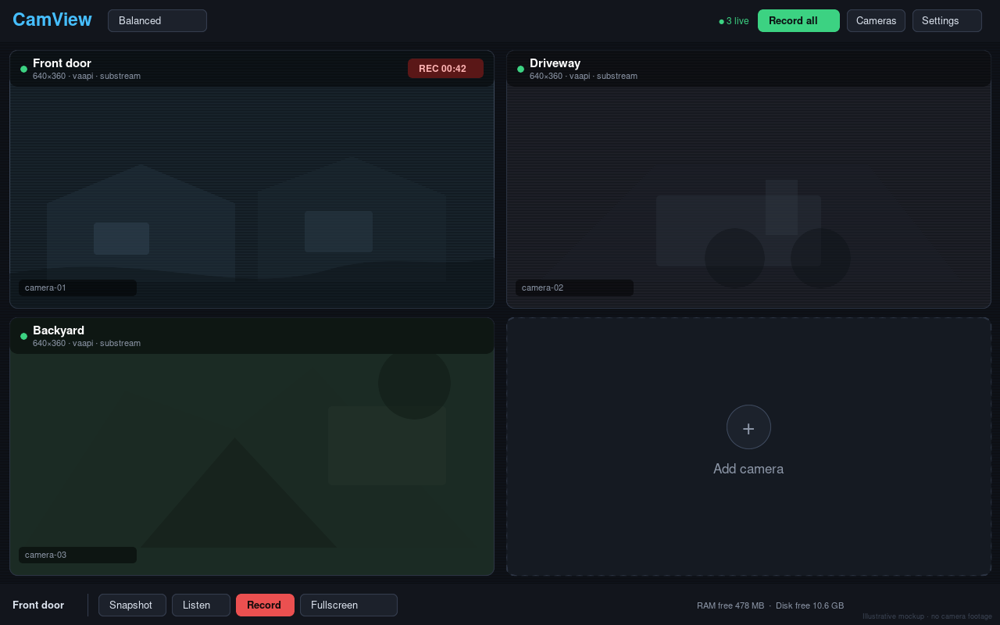
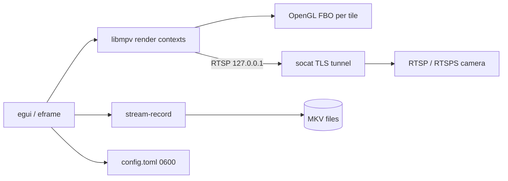

# CamView

[](https://github.com/orozcorgint/camview/actions/workflows/ci.yml)
[](LICENSE)
[](https://www.rust-lang.org/)

A native, lightweight multi-camera RTSP viewer and recorder for Linux, built
for low-power x86 machines. It uses **libmpv** for hardware-accelerated video,
**egui/eframe** for a small OpenGL UI, and **socat** for local TLS termination
when a camera only exposes RTSPS.

The project was designed around a strict memory budget (1.8 GB RAM, Intel Atom
tablet) and keeps a **single RTSP session per camera** while still allowing
simultaneous viewing and recording.

> **No camera footage, credentials or personal network data are included in
> this repository.** The screenshot below is an illustrative UI mockup.



## Features

- Multi-camera grid (1/4/9 tiles, pages) and double-click fullscreen.
- Add, edit, test and remove RTSP/RTSPS cameras.
- App-managed TLS tunnels bound to `127.0.0.1` (one `socat` per RTSPS camera).
- Grid uses the low-resolution substream; fullscreen switches to the main stream.
- Quality profiles (Eco / Balanced), render FPS cap and live-tile limit.
- Snapshots with timestamp.
- Per-camera audio monitoring; audio is included in recordings.
- Record / stop per camera and record-all. Recording is a **stream copy** to
  Matroska (no re-encoding, no extra CPU or camera connection).
- Selectable recording folder and a free-space guard.
- Autostart, single-instance guard, rotating logs and `0600` configuration.
- Clean shutdown finalizes the active recording.

## Why this project exists

Most desktop camera viewers assume a modern GPU and plenty of RAM. CamView was
built to answer a different question: can a 3-camera viewer + recorder run
comfortably on a 1.8 GB Atom tablet while keeping the camera connections free
for another application?

The answer is yes. The key design choices are:

| Constraint | Decision |
|---|---|
| Only 2 RTSP sessions on common consumer cameras | One `libmpv` session per camera; viewer and recorder share it through `stream-record` |
| Weak GPU | VA-API H.264 decoding and an OpenGL FBO per tile, no CPU colour conversion |
| 1.8 GB RAM | Substreams in the grid, main stream only on fullscreen, max live tiles, RAM watchdog |
| Some cameras' RTSPS handshakes fail in ffmpeg/gnutls | Small `socat` OpenSSL tunnel to localhost, one per RTSPS camera |
| No transcoding budget | Recording is a container-level copy (H.264/AAC/PCM into MKV) |

## Architecture



- **UI:** `eframe`/`egui` with the `glow` OpenGL backend.
- **Video:** one `libmpv` core per visible camera, rendered into a tile-sized FBO
  and composited by a small GLSL shader.
- **Transport:** cameras that speak RTSPS are reached through a local
  `socat` listener; the listener is created and supervised by the app and dies
  with it.
- **Recording:** mpv's `stream-record` property on the existing player session.
  No second connection and no ffmpeg process per recording.
- **No web server, no cloud dependency, no telemetry.**

See [docs/ARCHITECTURE.md](docs/ARCHITECTURE.md) for details and trade-offs.

## Performance

Measured on Debian 13, Intel Atom Z3735F (4 cores), 1.8 GB RAM, Mesa i965:

| Scenario | RSS | CPU (one core) |
|---|---|---|
| 3 cameras, 640×360 substreams, grid | ~215 MB | ~0.44 |
| 1 camera, 2560×1440 main stream, fullscreen | ~250 MB | ~0.50 |
| 3 simultaneous stream-copy recordings | no extra process | ~0.05 |

The numbers are indicative, not a guarantee; camera bitrate, scene complexity
and the rest of the desktop matter.

## Requirements

Runtime:

- Linux with X11 (XWayland works; native Wayland is not enabled in v0.1).
- `libmpv2`
- `socat` (only for RTSPS cameras)
- `ffprobe` (only used by the "Test camera" button)
- A working VA-API driver is strongly recommended for 1080p/1440p streams.

Build (Debian/Ubuntu):

```bash
sudo apt install rustc cargo pkg-config libmpv-dev libssl-dev \
  libx11-dev libxkbcommon-dev libxkbcommon-x11-dev libxcursor-dev \
  libxrandr-dev libxi-dev libgl1-mesa-dev libegl1-mesa-dev libwayland-dev
```

## Build and run

```bash
git clone https://github.com/orozcorgint/camview.git
cd camview
cargo build --release
./target/release/camview
```

Install for the current user:

```bash
make install          # binary, desktop entry and icon under ~/.local
```

The desktop entry uses the absolute install path, so it works even when
`~/.local/bin` is not in `PATH`.

The release build is intentionally conservative. On very small machines it can
take a while; use `CARGO_BUILD_JOBS=2` to keep memory pressure under control.

## Usage

1. Launch **CamView** from the application menu or with
   `~/.local/bin/camview`.
2. Open **Cameras → + Add camera**.
3. Enter a name, host/IP, RTSP port, stream paths and credentials.
   Enable **TLS** for RTSPS cameras (CamView will create the local tunnel).
4. Use **Test** to verify the connection before relying on it.
5. Choose a recording folder in **Settings**, then use **Record** or
   **Record all**.

The first launch can import cameras from an existing M3U playlist
(`~/cameras.m3u` or the legacy `~/camaras.m3u`) in **read-only** mode. CamView
never modifies the source playlist, its player settings or its services.

## Configuration and data

| Path | Purpose |
|---|---|
| `~/.config/camview/config.toml` | Camera list and preferences (`0600`) |
| `~/Videos/CamView/<camera>/<date>/*.mkv` | Recordings |
| `~/Pictures/CamView/` | Snapshots |
| `~/.local/state/camview/camview.log` | Rotating log (credentials redacted) |

The config stores camera credentials because the app needs them to build RTSP
URLs. It is written with mode `0600`; logs and UI strings redact userinfo.
Do not commit `config.toml`, recordings, snapshots or logs. See
[`docs/example-config.toml`](docs/example-config.toml) for the schema.

## Security notes

- Local tunnels bind to `127.0.0.1` only.
- There is no inbound HTTP server, no remote access and no cloud sync.
- Many consumer cameras use self-signed certificates; the tunnel uses
  OpenSSL with certificate verification disabled for compatibility. This is a
  deliberate trade-off for a trusted LAN. See [SECURITY.md](SECURITY.md).
- The app is a single-user desktop application and does not implement user
  accounts or privilege separation.

## Tests and diagnostics

```bash
cargo fmt --all -- --check
cargo test --release
cargo run --release -- --selftest
```

`--selftest` exercises the configured cameras, TLS tunnels, VA-API decoding and
a short recording. It requires real cameras and is not run in CI.
`--import-m3u` performs a read-only import from a legacy M3U playlist.

## Limitations / roadmap

- No PTZ/ONVIF, motion detection, schedules, notifications or retention rules
  in v0.1.
- The app must be running to record.
- One process, one desktop user; no web or mobile client.
- Future work is tracked in [docs/ROADMAP.md](docs/ROADMAP.md).

## Contributing and AI agents

Contributions are welcome. Read [CONTRIBUTING.md](CONTRIBUTING.md) before
opening a PR. If you are an AI coding agent, start with [AGENTS.md](AGENTS.md);
it documents the layout, invariants, build commands and security rules.

## License

MIT. See [LICENSE](LICENSE).

CamView links dynamically against libmpv (LGPL-2.1+) and uses `socat`,
`ffprobe` and the system OpenGL/Vulkan stack at runtime. Their licenses apply
to those components. See [THIRD_PARTY.md](THIRD_PARTY.md).
